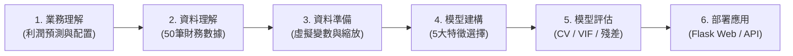

# 50 Startups: 多元線性迴歸與特徵選擇分析系統
### 50 Startups: Multiple Linear Regression & Feature Selection Explorer

本專案遵循國際標準資料探勘方法論 **CRISP-DM**（Cross-Industry Standard Process for Data Mining），針對經典的 **50 Startups 資料集** 建立多元線性迴歸（Multiple Linear Regression, OLS）模型，並深度橫向評測 **5 種特徵選擇演算法**（Feature Selection Algorithms）。

本作業旨在探討企業財務配置對新創公司獲利的影響機制，揭示特徵數量增減對模型泛化能力、過擬合（Overfitting）與多重共線性（Multicollinearity）的作用，並提供完整的互動式 **Flask Web 應用系統** 與 **REST API 預測服務**。

---

## 📋 作業核心目標與內容說明

### 1. 研究問題與業務理解 (Business Understanding)
- **目標**：利用新創企業的各項營運成本與設立州別，準確預測年度利潤（Profit），為創業投資（VC）與預算分配決策提供量化依據。
- **核心挑戰**：
  - 投入過多非顯著變數是否會引入隨機雜訊，導致測試集誤差上升（過擬合懸崖）？
  - 行銷支出與研發支出是否存在潛在相關性，導致多重共線性問題？
  - 如何透過客觀演算法自動篩選出兼具「高預測力」與「模型簡約性（Occam's Razor）」的特徵子集？

### 2. 5 大特徵選擇演算法實作與比較
本作業深入實作並對比以下 5 種特徵選擇技術（包含 $k=1 \dots 5$ 遞進子集評估）：
1. **Lasso (L1 正則化排序)**：利用 L1 罰項將次要係數壓縮至 0，依據標準化係數絕對值大小排序特徵重要性。
2. **Forward SFS (循序向前特徵選擇)**：由空集合開始，每次貪婪加入使交叉驗證 RMSE 改善最多的特徵。
3. **RFE (遞歸特徵消除)**：從全特徵出發，透過 OLS 權重逐步淘汰對模型貢獻最小的變數。
4. **ElasticNet (彈性網路排序)**：融合 L1 與 L2 正則化優勢，在高維與共線性環境下穩定評估特徵權重。
5. **Exhaustive Search (全子集窮舉搜尋)**：窮舉 $C(5, k)$ 所有可能子集組合，尋找數學上全域最優解。

---

## 🔬 CRISP-DM 六大階段實施架構



### Phase 1: 業務理解 (Business Understanding)
確立預測目標變數為連續型數值 `Profit`，自變數涵蓋研發、行政、行銷支出及地理區位，設定以 5-Fold 交叉驗證與獨立測試集 RMSE 作為核心客觀指標。

### Phase 2: 資料理解 (Data Understanding)
- **樣本規模**：50 間新創企業（50 列 $\times$ 5 欄）。
- **特徵欄位**：
  - `R&D Spend`：研發支出（連續型數值）
  - `Administration`：行政管理支出（連續型數值）
  - `Marketing Spend`：行銷推廣支出（連續型數值）
  - `State`：註冊州別（類別型：New York, California, Florida）
  - `Profit`：目標變數，企業獲利（連續型數值）
- **完整性檢驗**：無缺失值（Missing Values = 0）。

### Phase 3: 資料準備 (Data Preparation)
- **類別編碼**：對 `State` 進行 One-Hot Encoding，以 `California` 作為基準參考類別（Reference Category）自動剔除，生成 `State_Florida` 與 `State_New York` 兩個虛擬變數。
- **資料集切分**：按照 80% 訓練集（40 筆）與 20% 獨立測試集（10 筆）劃分。
- **特徵標準化**：使用 `StandardScaler` 對連續特徵進行 $Z$-score 正規化，供正則化模型與 RFE 消除量綱影響。

### Phase 4: 模型建構 (Modeling)
建立包含基準 OLS（全特徵 Baseline OLS）在內的 6 組模型，執行 5-Fold 交叉驗證搜尋最佳超參數與特徵子集。

### Phase 5: 模型評估與診斷 (Evaluation)
- **迴歸評估指標**：計算 MAE、MSE、RMSE、判定係數 $R^2$ 與校正判定係數 $\text{Adjusted } R^2$。
- **多重共線性診斷（VIF）**：針對最優特徵組合計算變異數膨脹因子（Variance Inflation Factor），確認 $\text{VIF} < 5$ 排除嚴重共線性。
- **殘差診斷（Outlier Diagnostics）**：排序出全樣本 Top 10 絕對殘差離群樣本，檢驗迴歸極端偏差成因。
- **特徵數量遞進實驗 ($k=1 \dots 5$)**：深入分析變數數量增減的邊際效益。

### Phase 6: 部署應用 (Deployment)
將最佳模型包裝為 Flask 互動式 Web 平台與標準 REST API，支援任意數值即時推論與迴歸係數貢獻度分解。

---

## 📊 核心實驗結論與發現 (Key Findings)

### 1. 最佳二特徵甜蜜點 ($k=2$ Sweet Spot)
在所有 5 種特徵選擇演算法中，模型高度一致收斂於 **`['R&D Spend', 'Marketing Spend']`**：
- **最低測試集 RMSE**：**`$8,198.80`**（相較於 Baseline OLS 顯著降低）
- **最高測試集 $R^2$**：**`0.9474`**（可解釋高達 94.74% 的獲利變異）
- **研發主導效益**：單一 `R&D Spend` 即可解釋超過 94.6% 的獲利（$k=1: R^2 = 0.9465$），加入 `Marketing Spend` 提供互補正向增益。

### 2. 全特徵過擬合懸崖 ($k=5$ Overfitting Cliff)
強制納入冗餘變數（行政費用 `Administration` 與州別虛擬變數）會引入干擾雜訊：
- **測試集 RMSE 大幅惡化**：由 **`$8,198.80`** 飆升至 **`$9,137.99`**（誤差增加逾 \$939！）
- **$R^2$ 退化**：由 **`0.9474`** 下降至 **`0.9347`**
- **實務啟示**：驗證了奧坎剃刀原則（Occam's Razor）——結構更簡單的 2 變數模型在預測穩定性、抗雜訊能力與可解釋性上全面優於 full-feature 模型。

---

## 📈 5 大特徵選擇演算法性能對照表

各演算法在獨立測試集上的評測數據如下（RMSE 單位：美元）：

| 特徵選擇演算法 | $k=1$ (RMSE) | $k=2$ (RMSE) | $k=3$ (RMSE) | $k=4$ (RMSE) | $k=5$ (RMSE) | 最佳特徵子集推薦 |
| :--- | :---: | :---: | :---: | :---: | :---: | :--- |
| **Lasso (L1 Ranking)** | $8,274.87 | **$8,198.80** | $8,309.06 | $8,409.92 | $9,137.99 | `['R&D Spend', 'Marketing Spend']` |
| **Forward SFS** | $8,274.87 | **$8,198.80** | $8,803.78 | $8,997.20 | $9,137.99 | `['R&D Spend', 'Marketing Spend']` |
| **RFE** | $8,274.87 | **$8,198.80** | $8,803.78 | $9,068.54 | $9,137.99 | `['R&D Spend', 'Marketing Spend']` |
| **ElasticNet Ranking** | $8,274.87 | **$8,198.80** | $8,803.78 | $8,997.20 | $9,137.99 | `['R&D Spend', 'Marketing Spend']` |
| **Exhaustive (窮舉搜尋)** | $8,274.87 | $8,198.80 | **$8,171.65** | $8,178.37 | $9,137.99 | `['R&D Spend', 'Admin', 'State_FL']` |

---

## 🖼️ 系統產出圖表清單

所有圖表均以高解析度（300 DPI）與現代出版級主題繪製：

1. **`feature_selection_comparison.png`**：5-Fold 交叉驗證 RMSE 橫向條狀圖（標註各演算法誤差與 Baseline OLS 對照基準）。
2. **`all_5_algorithms_comparison_plot.png`**：五大演算法在 $k=1 \dots 5$ 遞進過程中的 RMSE 與 $R^2$ 走勢，標示 $k=2$ 最優收斂區間。
3. **`actual_vs_predicted.png`**：獨立測試集上實際獲利 vs 預測獲利之 $y=x$ 理想對角線與指標標籤。
4. **`top10_outliers_plot.png`**：全樣本 50 家企業依州別分類散佈圖，清晰圈選並編號 `#1` 至 `#10` 最大絕對殘差點。
5. **各演算法雙面板遞進圖**（`lasso_l1_ranking_plot.png`, `forward_sfs_plot.png`, `rfe_plot.png`, `elasticnet_ranking_plot.png`, `exhaustive_search_plot.png`）。

---

## 💻 專案結構說明

```text
├── 50_Startups.csv                     # 50 間新創企業原始數據（本機快取）
├── requirements.txt                    # 專案相依套件庫清單
├── main.py                             # CRISP-DM 核心管線（OOP 架構，執行六大階段）
├── feature_progression_analysis.py     # 特徵遞進實驗腳本（產出 k=1..5 圖表、CSV 與資料模型）
├── app.py                              # Flask Web 應用程式與 REST API 後端服務
├── api/
│   └── index.py                        # Serverless 雲端部署 WSGI 入口點
├── templates/
│   └── index.html                      # 統計計算器風格前端介面
├── static/
│   └── model_data.js                   # 前端離線展示靜態數據模型
├── model_data.json                     # 完整 5 種演算法迴歸統計值與檢定參數
├── feature_selection_comparison.csv    # 演算法交叉驗證性能對照表
├── top10_outliers.csv                  # Top 10 最大殘差診斷表
└── README.md                           # 作業成果說明文件
```

---

## 🚀 執行指南

### 1. 安裝環境相依套件
確保 Python 環境為 3.10 以上版本，安裝必要套件：
```bash
pip install -r requirements.txt
```

### 2. 執行 CRISP-DM 迴歸主程式
執行端到端完整分析，輸出各階段統計報表、CSV 數據與主要診斷圖表：
```bash
python main.py
```

### 3. 執行特徵數量遞進分析 ($k=1 \dots 5$)
重新計算 5 種演算法在不同特徵規模下的指標，並同步更新圖表與資料模型：
```bash
python feature_progression_analysis.py
```

### 4. 啟動互動式 Web 預測平台
啟動本機 Flask 伺服器：
```bash
python app.py
```
開啟瀏覽器前往：**[http://localhost:5000/](http://localhost:5000/)**

---

## 🌐 Flask REST API 規範

- `GET /`：渲染互動式多元線性迴歸儀表板。
- `GET /api/models`：取得所有演算法之完整模型係數、Standard Error、$t$ 值、$p$ 值、信賴區間、VIF 與測試樣本。
- `GET /api/summary`：取得各演算法與特徵數量之摘要評估指標。
- `POST /api/predict`：即時利潤預測端點。
  - **請求範例 (Request)**：
    ```json
    {
      "algo": "Lasso",
      "k": 2,
      "rd_spend": 100000,
      "admin_spend": 120000,
      "marketing_spend": 150000,
      "state": "California"
    }
    ```
  - **回應範例 (Response)**：
    ```json
    {
      "status": "success",
      "algorithm": "Lasso",
      "k": 2,
      "active_features": ["R&D Spend", "Marketing Spend"],
      "predicted_profit": 130095.66,
      "rmse": 8198.80,
      "r2": 0.9474,
      "breakdown": [
        {"feature": "Intercept", "value": 1.0, "coef": 46346.34, "contribution": 46346.34},
        {"feature": "R&D Spend", "value": 100000.0, "coef": 0.7886, "contribution": 78861.83},
        {"feature": "Marketing Spend", "value": 150000.0, "coef": 0.0326, "contribution": 4886.49}
      ]
    }
    ```

---

## 🎨 網頁設計致敬與參考來源 (UI/UX Design References)

本專案的前端儀表板與互動實驗室介面風格深度參考並致敬 [**xAI 官方網站 (https://x.ai/)**](https://x.ai/) 的設計系統（Design System）與視覺語彙：

- **設計原型與模板參考 (Design Reference)**：[xAI Official Website (https://x.ai/)](https://x.ai/)
- **極簡未來感暗黑美學 (Minimalist Obsidian Dark Mode)**：全站以純黑（`#000000`）為底色，搭配 `1px solid rgba(255, 255, 255, 0.08)` 超細微邊框、低透明度半透明毛玻璃層次（Backdrop Blur）與高對比文字排版。
- **現代字體規範 (Typography Hierarchy)**：
  - 核心無襯線字體採用現代幾何造型的 **Geist Sans**（提供緊密字距與極具科技感的標題張力）。
  - 代碼、統計計量公式與數值指標採用 **Geist Mono** / **JetBrains Mono**，並配置 `tabular-nums` 以確保所有財務與殘差數值垂直精確對齊。
- **xAI 標誌性互動元件**：
  - **微浮動導覽列與公告藥丸 (Announcement Pill)**：模仿 xAI 首頁頂部的動態膠囊標籤（如 `[New] CRISP-DM 2.0 · Econometric Lab ↗`）。
  - **Bento Grid 模組化佈局**：將 KPI 指標、特徵步進按鈕、計量診斷表與動態圖表模組化收納。
  - **CLI 終端機參數試算控制台 (Developer Terminal Playground)**：將利潤預測模擬器改造為具備 macOS/Linux 終端機三色視窗圓點（紅、黃、綠）與命令列提示字元（`❯`）的互動面板，呼應 xAI 專為 AI 開發者打造的硬核工具氛圍。

